<!-- These SVG assets must exist in the repository root.
     Update the text inside terminal-card.svg and info-card.svg with Maryam's details.
     github-contribution-animation.svg must be generated for Maryam's contributions. -->

  

<table>
  <tr>
    <td valign="middle"></td>
    <td valign="top"></td>
  </tr>
</table>

<!-- HERO SECTION -->

  <h1>Hi, I'm Maryam Abdul Karim 👋</h1>
  <h3><strong>Computer Science Graduate | Aspiring AI Engineer</strong></h3>
  
<i>Exploring Artificial Intelligence, Machine Learning, AI Agents, and full-stack application development.</i>

  

    
    
    
  

  

 

<!-- ABOUT ME -->
<h2 align="center">🚀 About Me</h2>

<table width="100%">
  <tr>
    <td width="50%" valign="top">
      <h3>👩‍💻 Who am I?</h3>
      <ul>
        <li>🎓 <strong>Computer Science graduate</strong> building my skills in AI engineering and software development.</li>
        <li>🤖 Learning <strong>AI Engineering, Machine Learning, LLMs, and AI Agents.</strong></li>
        <li>📊 Exploring data preprocessing, feature engineering, and model evaluation.</li>
        <li>🌐 Building backend applications with <strong>Django and Django REST Framework.</strong></li>
        <li>📱 Exploring <strong>React Native and Expo</strong> for mobile application development.</li>
        <li>🛠️ Practicing with Git, GitHub, Docker, and collaborative development workflows.</li>
      </ul>
      <blockquote>
<i>Learning, building, and improving one project at a time.</i>
</blockquote>
    </td>
    <td width="50%" align="center" valign="middle">
      
    </td>
  </tr>
</table>

---

<!-- EDUCATION -->
<h2>🎓 Education</h2>

<strong>Computer Science Graduate</strong>

Continuing to develop practical skills in artificial intelligence, machine learning, data analysis, and application development through project-based learning.

<!-- Add your university, exact degree title, and graduation year here when ready. -->

<!-- TECH STACK -->
<h2>⚡ Tech Stack & Engineering Toolkit</h2>

<table width="100%">
  <tr>
    <td width="50%" valign="top">
      <h3>💻 Programming Languages</h3>
      
      <h3>🎨 Frontend Development</h3>
      
      <h3>⚙️ Backend Development</h3>
      
      
Django • Django REST Framework • REST APIs

      <h3>🗄️ Databases</h3>
      
      
SQL • MySQL

      <h3>📱 Mobile Development</h3>
      
React Native • Expo

    </td>
    <td width="50%" valign="top">
      <h3>🤖 Artificial Intelligence & Machine Learning</h3>
      

        
        
      

      
Machine Learning • Regression • Data Preprocessing • Feature Engineering • Model Evaluation • Predictive Modeling

      <h3>🧠 Generative AI & AI Agents</h3>
      
Exploring LLM Applications • AI Agents • Prompt Engineering • Generative AI • Intelligent Automation • API Integration

      <h3>📊 Data Science</h3>
      
Pandas • NumPy • Data Cleaning • Exploratory Data Analysis • Dataset Preparation • Statistical Analysis Fundamentals

      <h3>🛠️ Development Tools</h3>
      
    </td>
  </tr>
</table>

---

<!-- PROJECTS -->
<h2>💼 Featured Projects</h2>

<table width="100%">
  <tr>
    <td width="50%" valign="top">
      <h3>🏠 House Price Prediction</h3>
      
A machine learning project focused on predicting property prices using housing data, preprocessing techniques, feature engineering, and regression models.

      
<code>Python</code> <code>Pandas</code> <code>NumPy</code> <code>Scikit-learn</code>

      <ul>
        <li>Data preprocessing and feature preparation</li>
        <li>Regression-based predictive modeling</li>
        <li>Model evaluation and experimentation</li>
      </ul>
      
<a href="https://github.com/maryamabdulkarim361-lab?tab=repositories">Explore my repositories →</a>

    </td>
    <td width="50%" valign="top">
      <h3>🍋 Little Lemon Web Application</h3>
      
A restaurant-focused web development project involving backend functionality, application development, and API-related features.

      
<code>Python</code> <code>Django</code> <code>Django REST Framework</code> <code>SQL</code>

      <ul>
        <li>Backend application development</li>
        <li>REST API implementation</li>
        <li>Database integration</li>
      </ul>
      
<a href="https://github.com/maryamabdulkarim361-lab?tab=repositories">Explore my repositories →</a>

    </td>
  </tr>
  <tr>
    <td width="50%" valign="top">
      <h3>🤖 AI & Machine Learning Projects</h3>
      
Practical learning projects exploring machine learning algorithms, datasets, predictive modeling, and AI applications.

      
<code>Python</code> <code>Pandas</code> <code>NumPy</code> <code>Scikit-learn</code>

      <ul>
        <li>Data analysis and preprocessing</li>
        <li>Machine learning experimentation</li>
        <li>Predictive model development</li>
      </ul>
      
<a href="https://github.com/maryamabdulkarim361-lab?tab=repositories">Explore my repositories →</a>

    </td>
    <td width="50%" valign="top">
      <h3>🧠 AI Agents & LLM Applications</h3>
      
Exploring intelligent applications that use language models, APIs, and automated workflows to solve multi-step tasks.

      
<code>Python</code> <code>LLMs</code> <code>AI</code> <code>APIs</code>

      <ul>
        <li>LLM application exploration</li>
        <li>Prompt engineering</li>
        <li>Intelligent workflow automation</li>
      </ul>
      
<a href="https://github.com/maryamabdulkarim361-lab?tab=repositories">Explore my repositories →</a>

    </td>
  </tr>
</table>

---

<!-- EXPERIENCE & FOCUS AREAS -->
<h2>🚀 Project Experience & Engineering Focus</h2>

My learning journey combines machine learning, data analysis, backend development, and the exploration of AI-powered applications.

<table width="100%">
  <tr>
    <td width="50%" valign="top">
      <h3>🧠 AI & Machine Learning</h3>
      <ul>
        <li>Data preprocessing and feature engineering</li>
        <li>Regression and predictive modeling</li>
        <li>Model evaluation and experimentation</li>
        <li>LLM applications and Generative AI exploration</li>
        <li>AI Agent fundamentals and prompt engineering</li>
        <li>API integration and intelligent automation</li>
      </ul>
    </td>
    <td width="50%" valign="top">
      <h3>🌐 Backend Development</h3>
      <ul>
        <li>Django applications</li>
        <li>Django REST Framework</li>
        <li>REST API development</li>
        <li>SQL and MySQL</li>
        <li>Database and backend integration</li>
      </ul>
    </td>
  </tr>
  <tr>
    <td width="50%" valign="top">
      <h3>📱 Application Development</h3>
      <ul>
        <li>React</li>
        <li>React Native and Expo exploration</li>
        <li>Frontend integration</li>
        <li>AI-powered application concepts</li>
      </ul>
    </td>
    <td width="50%" valign="top">
      <h3>🛠️ Tools & Workflow</h3>
      <ul>
        <li>Python development</li>
        <li>Git and GitHub</li>
        <li>Docker fundamentals</li>
        <li>Collaborative development workflows</li>
        <li>Project-based learning and continuous improvement</li>
      </ul>
    </td>
  </tr>
</table>

---

<!-- GITHUB ANALYTICS -->
<h2>📈 GitHub Analytics & Open Source Activity</h2>

  

    
    
  

  

    
  

  

    
  

  

    
  

<!-- Requires a contribution-snake workflow in your profile repository that
     publishes github-contribution-grid-snake.svg to the output branch. -->
<h2>🐍 Contribution Graph</h2>

  

---

  <i>Learning, building, and improving one project at a time.</i>

